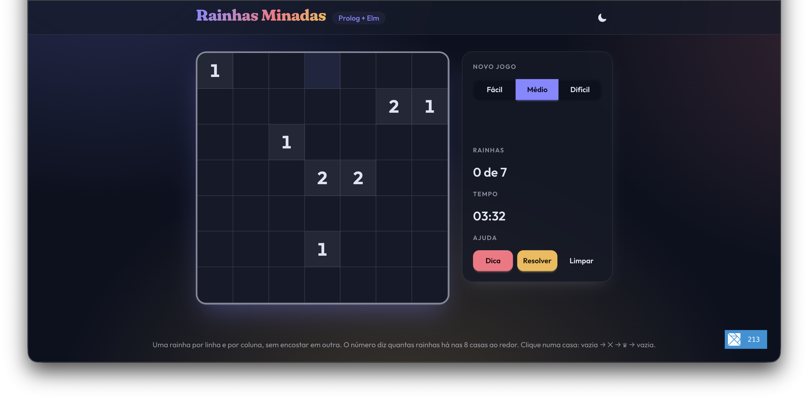

# Rainhas Minadas

## 1. Identificação

| Nome completo | Matrícula | Turma (14h/16h) | Usuário GitHub |
|---------------|-----------|-----------------|----------------|
| Arthur Fonseca Vale | 221031120 | 14h | @arthurfonsecaa |
| Ana Carolina Madeira Fialho | 221031102 | 14h | @anawcarol |
| Sunamita Vitória Rodrigues dos Santos | 221008697 | 14h | @Sunamit |
| Pedro Paulo Santos Almeida | 221008688 | 14h | @Pedrin0030 |
| Isabelle da Costa Figueiredo | 211039500 | 14h | @isacostaf |
| João Paulo Barros de Cristo | 202023805 | 14h | @joaopb1-xps |

- **Nome do projeto:** Rainhas Minadas
- **Nome do grupo:** Rainhas Minadas
- **Repositório:** https://github.com/Sunamit/paradigmas-trabalho
- **Commit ou tag entregue:** `v1.0`
- **Ponto de partida:** Remix original
- **Slides da apresentação oral:** não há

## 2. Resumo

Rainhas Minadas é um jogo de raciocínio que mistura N-rainhas com Campo Minado. O jogador coloca N rainhas num tabuleiro N×N (6×6, 7×7 ou 8×8): uma por linha e por coluna, sem que duas se encostem, nem na diagonal. Casas com número não têm rainha, e o número indica quantas rainhas há nas 8 casas ao redor. Todo puzzle tem solução única.

O Prolog é o cérebro do sistema: cada regra do jogo vira uma restrição CLP(FD), e o mesmo código resolve o puzzle, gera puzzles com solução única e calcula dicas. O Elm cuida da interface e da verificação instantânea de conflitos.



## 3. Como executar

**Requisitos** (com as versões que o grupo usou):

- SWI-Prolog 10.0.2 (macOS) e 11.0.0 (Windows); a biblioteca janus exige 9.2 ou mais novo
- Node.js 24.15.0 (20 ou mais novo)
- uv 0.13.9 e Python 3.11 ou mais novo (o uv instala o Python sozinho)

No Windows, o `janus-swi` é compilado na instalação, então também são necessárias as Build Tools do C++ (carga de trabalho "Desenvolvimento para desktop com C++").

**Instalação e execução:**

```sh
git clone https://github.com/Sunamit/paradigmas-trabalho.git
cd paradigmas-trabalho
cd backend && uv sync && cd ..
cd frontend && npm install && cd ..
```

Em seguida, em **dois terminais**:

```sh
# terminal 1: backend (http://localhost:8000/docs)
cd backend
uv run fastapi dev app/main.py
```

```sh
# terminal 2: frontend (http://localhost:5173)
cd frontend
npm run dev
```

**Testes:**

```sh
make test
```

Sem `make` (Windows):

```sh
swipl -g run_tests -t halt backend/prolog/test_rainhas.pl
cd backend && uv run pytest 
```

**Testado em:** macOS + Chrome e Windows 11 + Chrome.

## 4. Arquitetura

```
┌────────────────────────┐             ┌─────────────────────┐         ┌────────────────────┐
│ Navegador              │             │ FastAPI (Python)    │         │ SWI-Prolog         │
│                        │             │                     │         │                    │
│ Elm                    │  HTTP/JSON  │ app/main.py         │  janus  │ rainhas.pl         │
│ Rainhas.elm (domínio)  │ ──────────▶ │ app/prolog.py       │ ──────▶ │ CLP(FD)            │
│ Api.elm (HTTP/JSON)    │ ◀────────── │                     │ ◀────── │ solve/2, generate/2│
│ Main.elm (interface)   │             │ só integração       │         │ hint/3             │
│                        │             │                     │         │                    │
└────────────────────────┘             └─────────────────────┘         └────────────────────┘
  porta 5173                           porta 8000                (roda dentro do Python)
```

| Parte  | Responsabilidade | Arquivos principais |
|--------|------------------|---------------------|
| Prolog | Regras do jogo, resolvedor, gerador de puzzles com solução única e dica | `backend/prolog/rainhas.pl` |
| Elm    | Interface, verificação instantânea de conflitos e estado do jogo | `frontend/src/Rainhas.elm`, `frontend/src/Api.elm`, `frontend/src/Main.elm` |
| Python | Só integração: recebe JSON, chama o Prolog e devolve JSON | `backend/app/prolog.py`, `backend/app/main.py` |

## 5. Parte em Prolog

### 5.1 Predicados principais

Cada casa do tabuleiro é uma variável que vale 0 ou 1 (1 = rainha), e cada regra do jogo é uma restrição de soma do CLP(FD).

| Predicado | Local | O que faz |
|-----------|-------|-----------|
| `board_constraints(+N, ?Queens)` | `rainhas.pl:58` | As regras das rainhas: soma 1 em cada linha e coluna, e nenhuma rainha encostada em outra |
| `exactly_one(?Cells)` | `rainhas.pl:81` | A soma de uma linha ou coluna é 1 |
| `no_touching(?Rows)` | `rainhas.pl:87` | Percorre as linhas de duas em duas, por recursão |
| `squares(?Upper, ?Lower)` | `rainhas.pl:94` | Em todo quadrado 2×2 há no máximo 1 rainha; isso cobre todos os contatos, porque duas casas vizinhas sempre dividem algum 2×2 |
| `clue_constraints(+Puzzle, ?Queens)` | `rainhas.pl:103` | Aplica as restrições de cada pista |
| `clue_constraint(+Queens, +R-C-K)` | `rainhas.pl:114` | A casa da pista vale 0, e a soma das vizinhas é K |
| `neighbors(+Grid, +R-C, -Vars)` | `rainhas.pl:126` | As até 8 casas vizinhas de uma posição |
| `puzzle_constraints(+Puzzle, -Queens)` | `rainhas.pl:146` | Junta as regras das rainhas e as das pistas |
| `solve(+Puzzle, -Solution)` | `rainhas.pl:159` | Resolve o puzzle |
| `count_solutions(+Puzzle, +Limit, -Count)` | `rainhas.pl:168` | Conta as soluções até o limite; usado para garantir solução única |
| `difficulty_size(?Difficulty, ?N)` | `rainhas.pl:195` | Fatos: o tamanho do tabuleiro por nível (6, 7 e 8) |
| `generate(+Difficulty, -Puzzle)` | `rainhas.pl:200` | Gera um puzzle com solução única |
| `random_solution(+N, -Solution)` | `rainhas.pl:212` | Sorteia uma posição válida das rainhas |
| `random_labeling(+Vars)` | `rainhas.pl:220` | Como o `label/1`, mas tenta 0 e 1 em ordem aleatória |
| `reveal_until_unique/5` | `rainhas.pl:241` | Revela pistas aleatórias até a solução ficar única |
| `hide_redundant/3` | `rainhas.pl:251` | Esconde as pistas desnecessárias, deixando o puzzle enxuto |
| `hint(+Puzzle, +Board, -Result)` | `rainhas.pl:286` | Dica: a posição da próxima rainha, `complete` ou `unsolvable` |
| `keep_queen/2` | `rainhas.pl:304` | Fixa em 1 as rainhas que o jogador já colocou |

### 5.2 Conceitos do paradigma lógico utilizados

- [x] Fatos e regras como base de conhecimento: os fatos `difficulty_size/2` (`rainhas.pl:195`) dão o tamanho do tabuleiro por nível, e `no_clue/1` (`rainhas.pl:49`) define o valor de "casa sem pista". As regras do jogo são predicados como `board_constraints/2` (`rainhas.pl:58`) e `clue_constraint/2` (`rainhas.pl:114`).
- [x] Unificação e casamento de padrões: `squares/2` separa as duas primeiras casas de cada linha com `[A, B | As]` (`rainhas.pl:95`); `clue_constraint/2` desmonta a pista com `R-C-K` (`rainhas.pl:114`); `keep_queen/2` escolhe a cláusula pelo valor da casa, `1` ou `0` (`rainhas.pl:304`).
- [x] Recursão (inclusive sobre listas): `no_touching/1` (`rainhas.pl:87`) e `squares/2` (`rainhas.pl:94`) percorrem as linhas; `random_labeling/1` (`rainhas.pl:220`), `reveal_until_unique/5` (`rainhas.pl:241`) e `hide_redundant/3` (`rainhas.pl:251`) percorrem listas, cada um com seu caso base.
- [x] Backtracking e múltiplas soluções: `clue_at/4` (`rainhas.pl:108`) enumera as pistas por backtracking sobre `nth0/3`; `random_labeling/1` usa `member/2` como ponto de escolha (`rainhas.pl:225`); `count_solutions/3` (`rainhas.pl:168`) volta atrás para enumerar as soluções e contá-las.
- [x] `findall/3`, `bagof/3`, `setof/3` ou similares: `findall/3` em `clue_constraints/2` (`rainhas.pl:104`), `neighbors/3` (`rainhas.pl:129`), `count_solutions/3` (`rainhas.pl:169`), `generate/2` (`rainhas.pl:205`) e `hint/3` (`rainhas.pl:291`). Como o `findall/3` copia as variáveis, o `neighbors/3` coleta só as posições e depois busca as variáveis com `maplist/3` (`rainhas.pl:136`).
- [x] Corte (`!`) ou negação (`\+`), e por que foram necessários: o corte em `solve/2` (`rainhas.pl:163`) fica só com a primeira solução encontrada, sem procurar outras se o usuário pedir mais. Em `generate/2` (`rainhas.pl:209`) e `random_solution/2` (`rainhas.pl:216`), o corte impede que o backtracking gere outro puzzle depois do primeiro. Em `reveal_until_unique/5` (`rainhas.pl:243`), ele para de revelar pistas quando a solução fica única. Em `keep_queen/2` (`rainhas.pl:304`), evita deixar um ponto de escolha desnecessário. Não usamos negação (`\+`).
- [x] Programação por restrições (CLP(FD) ou outra): `ins 0..1` declara cada casa como 0 ou 1 (`rainhas.pl:66`); `sum/3` exige soma 1 por linha e coluna (`rainhas.pl:82`) e soma K ao redor de cada pista (`rainhas.pl:118`); `#=<` limita cada quadrado 2×2 a uma rainha (`rainhas.pl:96`); `labeling/2` com a heurística `ff` encontra os valores em `solve/2` (`rainhas.pl:162`), `count_solutions/3` e `hint/3`.
- [x] Predicados de ordem superior (`maplist`, `foldl`, `include`...): `maplist(exactly_one, Queens)` e `maplist(exactly_one, Columns)` em `board_constraints/2` (`rainhas.pl:69` e `73`); `maplist(clue_constraint(Queens), Clues)` com aplicação parcial (`rainhas.pl:105`); `maplist(maplist(keep_queen), Board, Solution)` em `hint/3` (`rainhas.pl:288`), um `maplist` dentro de outro, para percorrer a grade.
- [x] Outro: `limit/2` em `count_solutions/3` (`rainhas.pl:170`) para de contar ao chegar no limite (para saber se a solução é única, basta ver se existem 2); e o se-então-senão (`->` / `;`) em `hint/3` (`rainhas.pl:286`) e `hide_redundant/3` (`rainhas.pl:255`).

### 5.3 Trecho em destaque

As regras das rainhas, em `board_constraints/2` e `squares/2` (`rainhas.pl:55` a `98`; alguns comentários foram encurtados aqui):

```prolog
board_constraints(N, Queens) :-
    length(Queens, N),
    maplist(same_length(Queens), Queens),
    append(Queens, Cells),
    Cells ins 0..1,

    % Uma rainha por linha: a soma dos 0/1 da linha é 1.
    maplist(exactly_one, Queens),

    % Uma rainha por coluna: mesma restrição sobre a grade transposta.
    transpose(Queens, Columns),
    maplist(exactly_one, Columns),

    % Nenhuma rainha encostada: em todo quadrado 2x2 há no máximo uma.
    no_touching(Queens).

exactly_one(Cells) :-
    sum(Cells, #=, 1).

no_touching([_]).
no_touching([Upper, Lower | Rest]) :-
    squares(Upper, Lower),
    no_touching([Lower | Rest]).

squares([_], [_]).
squares([A, B | As], [C, D | Cs]) :-
    A + B + C + D #=< 1,
    squares([B | As], [D | Cs]).
```

**O que é declarado:**

- O tabuleiro é uma lista de N linhas com N variáveis cada, e `Cells ins 0..1` diz que cada casa vale 0 (vazia) ou 1 (rainha).
- "Uma rainha por linha" vira literalmente "a soma da linha é 1" (`exactly_one/1`). Para as colunas, usamos a mesma regra sobre a grade transposta (`transpose/2`), sem escrever código novo.
- "Nenhuma rainha encostada" vira "todo quadrado 2×2 tem soma no máximo 1". O `no_touching/1` pega as linhas de duas em duas, e o `squares/2` desliza uma janela 2×2 por elas, casando o padrão `[A, B | As]` com `[C, D | Cs]`.
- O truque do 2×2: duas casas vizinhas, inclusive na diagonal, sempre dividem algum quadrado 2×2. Por isso essa única restrição cobre todos os tipos de contato, sem precisar tratar diagonais separadamente.

**Como o Prolog chega à resposta:** este predicado não procura nada; ele só monta as restrições. Ao receber cada restrição, o CLP(FD) já elimina valores impossíveis (por exemplo, quando uma casa da linha vira 1, as outras são forçadas a 0). Depois, o `labeling/2` em `solve/2` (`rainhas.pl:162`) tenta valores para as casas que sobraram e, se uma restrição falha, o backtracking do Prolog volta atrás e tenta outro valor.

**Por que é lógico e não imperativo:** não há nenhum laço de busca, nenhum "coloque uma rainha, verifique, remova" escrito por nós. O código descreve *o que* é um tabuleiro válido, quase com as mesmas palavras das regras do jogo, e deixa *como* encontrá-lo para o resolvedor. As mesmas restrições servem para resolver (`solve/2`), contar soluções (`count_solutions/3`), sortear um tabuleiro (`random_solution/2`) e dar dicas (`hint/3`), mudando apenas o que é feito depois de declará-las.

## 6. Parte em Elm

### 6.1 Modelo e mensagens

Domínio (`frontend/src/Rainhas.elm:48`, `:58` e `:72`):

```elm
type Cell
    = Clue Int -- pista do puzzle: quantas rainhas há ao redor (não muda)
    | Queen Origin -- rainha
    | Cross -- o jogador marcou que ali NÃO vai rainha
    | Empty

type Origin
    = Player
    | Prolog

type alias Board =
    { size : Int
    , cells : Array Cell
    }
```

Estado e eventos (`frontend/src/Main.elm:57` e `:88`):

```elm
type alias Model =
    { board : Board
    , difficulty : Difficulty
    , darkTheme : Bool
    , loading : Bool
    , error : Maybe String
    , seconds : Int
    }

type Msg
    = NewGame Difficulty
    | GotPuzzle (Result String Board)
    | CellClicked Position
    | ThemeToggled Bool
    | HintRequested
    | GotHint (Result String Position)
    | SolveRequested
    | GotSolution (Result String (Set Position))
    | ResetRequested
    | ErrorDismissed
    | Tick Time.Posix
```

- **`Cell` é um custom type, e não dois `Bool`.** Com `temPista` e `temRainha`, uma casa poderia ser pista e rainha ao mesmo tempo, o que as regras proíbem. Com `Cell`, esse estado não pode ser escrito. `setCell` (`frontend/src/Rainhas.elm:302`) completa a garantia: nunca troca uma pista.
- **`Origin` fica dentro de `Queen`.** Só rainha tem origem, então uma casa vazia "colocada pelo Prolog" também não existe. A origem define a classe CSS (`frontend/src/Main.elm:352`) e a mensagem de fim de jogo (`frontend/src/Main.elm:263`).
- **`Difficulty` é um custom type, e não `String`** (`frontend/src/Api.elm:24`). Um nível com erro de digitação não compila; a conversão para texto fica só em `difficultyToString` (`frontend/src/Api.elm:45`).
- **`error : Maybe String`** representa a ausência de erro sem null nem texto vazio. Para mostrar a mensagem, `viewMessages` (`frontend/src/Main.elm:239`) precisa tratar também o caso `Nothing`.
- **As mensagens `Got...` carregam um `Result`** com o tipo exato de cada resposta: um tabuleiro, uma posição ou um conjunto de posições. O `update` é obrigado a tratar `Ok` e `Err`.
- **`seconds : Int`** guarda o tempo de jogo do cronômetro. Ele só muda pela mensagem `Tick`, e volta a 0 em `NewGame` e `ResetRequested`.
- **O que não está no `Model`:** conflitos, contagem de rainhas e vitória são calculados a partir do tabuleiro (`conflicts`, `queenCount`, `isComplete`). Assim não podem ficar desatualizados.

`loading` e `error` ainda são campos independentes, então o tipo permite os dois ativos ao mesmo tempo. O `update` evita isso na prática; um custom type para o estado da requisição impediria no próprio tipo.

### 6.2 Conceitos do paradigma funcional utilizados

- [x] Arquitetura Elm (Model, update, view): `Model` (`frontend/src/Main.elm:57`), `update` (`frontend/src/Main.elm:102`) e `view` (`frontend/src/Main.elm:172`).
- [x] Custom types e `case` exaustivo: `Cell` (`frontend/src/Rainhas.elm:48`), `cycle` (`frontend/src/Rainhas.elm:318`), o `case` sobre tupla de `revealSolution` (`frontend/src/Rainhas.elm:342`) e `cellClass` (`frontend/src/Main.elm:352`), que não tem `_`: um construtor novo em `Cell` faz o compilador apontar a função.
- [x] `Maybe` e `Result` no lugar de null e exceções: `error` no `Model` (`frontend/src/Main.elm:62`), `queensOf` com `List.filterMap` (`frontend/src/Api.elm:133`) e `expectJson`, que transforma todas as falhas HTTP em `Err` (`frontend/src/Api.elm:171`).
- [x] Funções de ordem superior e aplicação parcial: `toRows` recebe a função que converte cada casa (`frontend/src/Rainhas.elm:142`); `attack queen` e `clueExceeded board` são aplicações parciais (`frontend/src/Rainhas.elm:255` e `:258`), assim como `viewCell board conflicts` (`frontend/src/Main.elm:318`).
- [x] Composição (`|>`, `>>`): pipelines com `|>` em `fromPuzzle` (`frontend/src/Rainhas.elm:89`), `queensAround` (`frontend/src/Rainhas.elm:227`) e `queensOf` (`frontend/src/Api.elm:133`). Não usamos `>>`.
- [x] Decoders e encoders JSON: `encodeGrid` (`frontend/src/Api.elm:107`), `puzzleDecoder` (`frontend/src/Api.elm:119`), `solutionDecoder` (`frontend/src/Api.elm:127`) e `hintDecoder` com `Decode.map2` (`frontend/src/Api.elm:156`).
- [x] Comandos e subscriptions (efeitos controlados): `generate`, `solve` e `hint` devolvem um `Cmd msg` (`frontend/src/Api.elm:62`, `:76` e `:88`). O cronômetro é uma subscription: `subscriptions` (`frontend/src/Main.elm:37`) assina `Time.every 1000 Tick` só enquanto o jogo está em andamento, e devolve `Sub.none` quando o puzzle está carregando ou resolvido.
- [x] Imutabilidade e atualização de records: `setCell` (`frontend/src/Rainhas.elm:302`) e `clear` (`frontend/src/Rainhas.elm:371`) devolvem um tabuleiro novo; todo o `update` cria um `Model` novo com a sintaxe `{ model | ... }`.
- [x] Outro: domínio puro isolado em módulo. `Rainhas.elm` não importa HTTP nem HTML, só `Array` e `Set` (`frontend/src/Rainhas.elm:33`), e não exporta auxiliares como `setCell` e `attack`.

### 6.3 Trecho em destaque

`conflicts` e `clueExceeded` (`frontend/src/Rainhas.elm:248` e `:263`) decidem quais casas ficam vermelhas a cada clique:

```elm
conflicts : Board -> Set Position
conflicts board =
    let
        queens =
            queenPositions board

        badQueens =
            List.filter (\queen -> List.any (attack queen) queens) queens

        badClues =
            List.filter (clueExceeded board) (positions board)
    in
    Set.fromList (badQueens ++ badClues)


clueExceeded : Board -> Position -> Bool
clueExceeded board position =
    case cellAt position board of
        Clue k ->
            queensAround position board > k

        _ ->
            False
```

- **Descreve o resultado, sem laço nem variável alterada.** As rainhas em conflito são "as rainhas que atacam alguma rainha", e o código diz isso com `List.filter` e `List.any`.
- **Aplicação parcial.** `attack` recebe duas posições; `attack queen` já é uma função que espera a segunda, e é ela que `List.any` usa. `clueExceeded board` segue a mesma ideia.
- **A rainha não ataca a si mesma**, embora seja comparada com a lista inteira: `attack` exige `p1 /= p2` (`frontend/src/Rainhas.elm:239`).
- **Pista com rainhas de menos não é conflito**, porque o jogador pode não ter terminado. Por isso a comparação é `>`; a igualdade só é exigida na vitória, por `clueSatisfied` (`frontend/src/Rainhas.elm:273`).
- **`Set`** elimina repetições e combina com a única pergunta que a view faz: "esta casa está em conflito?" (`frontend/src/Main.elm:339`).

Essa verificação repete parte das regras do Prolog de propósito: assim a resposta ao clique não depende da rede. Resolver, gerar e dar dicas continuam só no Prolog.

## 7. Integração

O Elm envia JSON para `/api`, o Vite repassa ao FastAPI (`frontend/vite.config.js:13`) e o Python chama o Prolog pela biblioteca janus (`backend/app/prolog.py`). No puzzle, `-1` é casa sem pista e `0` a `8` é pista; nas rainhas, `1` é rainha e `0` é casa sem rainha.

| Rota / chamada | Entrada | Saída | Predicado Prolog |
|----------------|---------|-------|------------------|
| `POST /api/generate` (`backend/app/main.py:66`) | `{"difficulty": "easy"}` (ou `"medium"`, `"hard"`) | `{"puzzle": [[...], ...]}` | `generate/2` (`backend/prolog/rainhas.pl:200`) |
| `POST /api/solve` (`backend/app/main.py:71`) | `{"puzzle": [[...], ...]}` | `{"queens": [[...], ...]}` | `solve/2` (`backend/prolog/rainhas.pl:159`) |
| `POST /api/hint` (`backend/app/main.py:79`) | `{"puzzle": [[...], ...], "queens": [[...], ...]}` | `{"row": 2, "col": 4}` | `hint/3` (`backend/prolog/rainhas.pl:286`) |

Se o puzzle não tem solução, se há rainha errada ou se não resta dica a dar, a resposta é 422 com `{"detail": "mensagem"}`, e o Elm mostra essa mensagem (`errorDetail`, `frontend/src/Api.elm:193`). JSON fora do formato também recebe 422, mas do Pydantic, antes de chegar ao Prolog.

## 8. Testes e validação

Para rodar os testes do Prolog e da API: `make test`. Para os testes do Elm: `cd frontend && npx elm-test`.

**Testes do Prolog (plunit):** 15 verificações em `backend/prolog/test_rainhas.pl`, em 3 grupos.

- `solve` (`test_rainhas.pl:20`):
  - `solve/2` encontra a solução esperada do puzzle de exemplo;
  - o exemplo tem solução única (`count_solutions/3` devolve 1);
  - nenhuma casa com pista recebe rainha;
  - uma pista 4 num canto, que só tem 3 vizinhas, não tem solução;
  - um tabuleiro 3×3 não tem solução, porque não cabem 3 rainhas sem encostar.
- `generate` (`test_rainhas.pl:55`):
  - nos 3 níveis, o puzzle gerado tem solução única (3 verificações);
  - nos 3 níveis, o tabuleiro tem o tamanho certo, 6, 7 e 8 (3 verificações);
  - um nível inválido gera um erro de tipo.
- `hint` (`test_rainhas.pl:70`):
  - num tabuleiro vazio, a dica aponta uma casa que tem rainha na solução;
  - com a solução completa, a dica responde `complete`;
  - com uma rainha no lugar errado, a dica responde `unsolvable`.

**Testes da API (pytest):** 7 testes em `backend/tests/test_api.py`, usando o `TestClient` do FastAPI, sem subir servidor. Eles conferem só a integração (rotas, formato do JSON e códigos de status), porque as regras já são testadas em Prolog:

- `/api/solve` devolve a solução certa; responde 422 para um puzzle sem solução e para um JSON malformado;
- `/api/generate` devolve um tabuleiro 6×6 com pistas e casas vazias;
- `/api/hint` devolve uma rainha da solução; responde 422 com a mensagem certa quando o tabuleiro já está completo e quando há uma rainha errada.

**Testes manuais na interface:**

- Duas rainhas encostadas ficam vermelhas.
- Uma pista com mais rainhas ao redor do que o seu número fica vermelha.
- Pedir uma dica com uma rainha errada mostra a mensagem de erro do backend.
- O botão Resolver completa o tabuleiro, mantendo as rainhas certas do jogador.
- O botão Limpar apaga tudo e mantém só as pistas.

**Testes do domínio Elm (`elm-test`):** testes unitários do domínio puro em `frontend/tests/RainhasTest.elm`, usando `frontend/src/Rainhas.elm` sem necessidade de navegador ou servidor:

- Conversões e estado inicial (`fromPuzzle`, `toPuzzle`, `toQueens`, `queenCount`, `clear`): leitura do tamanho do tabuleiro, mapeamento de `-1` e pistas `0..8`, ida e volta do puzzle ignorando marcações/rainhas, grade binária de rainhas e limpeza mantendo pistas;
- Interação e imutabilidade (`cycle`, `placeQueen`): alternância entre vazia, marcação `X`, rainha do jogador e vazia, bloqueio em pistas e fora do tabuleiro, e preservação do tabuleiro original;
- Vizinhança, conflitos e conclusão (`queensAround`, `conflicts`, `isComplete`, `revealSolution`): contagem das 8 casas vizinhas sem contar a própria casa nem `X`, detecção de conflitos em linha/coluna/diagonal adjacente e excesso em pistas, validação de tabuleiro completo e revelação da solução mantendo rainhas corretas do jogador e marcando as restantes como `Prolog`.

**Casos de borda considerados:**

- Puzzle sem solução: o Prolog falha, e a API responde 422 com uma mensagem que o Elm mostra na tela.
- Rainha errada na hora da dica: a dica responde `unsolvable`, e o jogador é avisado.
- Tabuleiro já completo: a dica responde `complete`, em vez de inventar uma jogada.
- JSON malformado (grade com menos de 4 ou mais de 8 linhas ou colunas, pista fora de -1 a 8, rainha diferente de 0 ou 1): o Pydantic recusa, com 422, antes de o Prolog ser chamado (`main.py:23` a `30`).
- Nível de dificuldade inválido: `generate/2` lança um erro de tipo (`must_be/2`), em vez de falhar em silêncio.

## 9. Limitações e problemas conhecidos

- **`make dev` nem sempre sobe o backend no macOS.** Em alguns testes, só o Vite iniciou e o jogo mostrou "Erro no servidor (código 502)". Rodar backend e frontend em dois terminais, como na seção 3, resolve.
- **A dificuldade muda só o tamanho do tabuleiro** (6, 7 ou 8), e não as técnicas de dedução necessárias. Um 8×8 pode sair mais fácil que um 7×7.
- **O gerador tira pistas de forma gulosa** (`hide_redundant/3`): o puzzle final não tem pistas sobrando, mas não necessariamente tem o menor número possível de pistas.
- **A dica diz onde vai uma rainha, mas não explica por quê.**
- **A verificação instantânea do Elm é parcial:** ela aponta rainhas que se atacam e pistas com rainhas demais, mas não percebe uma rainha que não ataca ninguém e ainda assim está fora da solução. Isso só aparece ao pedir uma dica.
- **O cronômetro conta ticks de 1 segundo.** Com a aba em segundo plano, o navegador pode atrasar os ticks, e o tempo mostrado fica menor que o real.
- **Não há controle por teclado** nem pausa do cronômetro.
- **Com mais tempo:** dicas explicadas pelo Prolog (qual regra força a rainha), níveis medidos pelas técnicas de dedução, pausa do cronômetro e controle por teclado.

## 10. Contribuição de cada integrante

| Integrante | Principais contribuições |
|------------|--------------------------|
| Sunamita Vitória Rodrigues dos Santos | Coordenação do grupo; implementação do Prolog (`rainhas.pl`, `test_rainhas.pl`), da ponte Python (`prolog.py`, `main.py`, `test_api.py`) e do Elm (`Rainhas.elm`, `Api.elm`, `Main.elm`), com uso intensivo de IA (seção 11); correção da dependência `elm/time`, revisão final e seções 9 a 13 do relatório |
| Arthur Fonseca Vale | Seções 1 (Identificação), 2 (Resumo), 3 (Como executar) e 4 (Arquitetura) do relatório |
| Ana Carolina Madeira Fialho | Seções 6 (Elm) e 7 (Integração) do relatório; aplicação do `elm-format` nos módulos Elm |
| Isabelle da Costa Figueiredo | Seções 5 (Prolog: predicados, conceitos e trecho em destaque) e 8 (Testes e validação) do relatório |
| Pedro Paulo Santos Almeida | Limpeza do template do Sudoku, reescrita do README e integração dos pull requests das seções 5 a 8 |
| João Paulo Barros de Cristo | Cronômetro (subscription com `Time.every`) e testes do domínio Elm com elm-test (`frontend/tests/RainhasTest.elm`) |

## 11. Fontes, código de terceiros e uso de IA

**Código reaproveitado.** Partimos do template do Sudoku do professor (`fabiommendes/paradigmas-trabalho-final`). Mantivemos a estrutura do servidor FastAPI e da ponte com o janus, a configuração do Vite, o `main.js`, o tratamento de erros HTTP do `Api.elm` (`expectJson` e `errorDetail`) e o `style.css`, ao qual acrescentamos o bloco do tabuleiro N×N. Foram escritos para este jogo: `rainhas.pl`, `test_rainhas.pl`, `Rainhas.elm`, `RainhasTest.elm` e as novas versões de `Api.elm`, `Main.elm`, `prolog.py`, `main.py` e `test_api.py`.

**Referências.** Manual do SWI-Prolog (bibliotecas `clpfd`, `plunit` e `janus`); guia oficial do Elm (guide.elm-lang.org) e documentação dos pacotes `elm/json`, `elm/http` e `elm/time`; README e código do template do professor.

**Uso de ferramentas de IA.**

- **Faixa de uso no código:** intensivo

| Ferramenta | Para que foi usada | Como o grupo verificou o resultado |
|------------|--------------------|------------------------------------|
| Claude (Anthropic) | Escreveu a maior parte do código: as regras, o resolvedor, o gerador e a dica em Prolog, a ponte Python, os módulos Elm e os testes plunit e pytest. Também orientou a divisão de tarefas e revisou o relatório | Rodamos os testes plunit, pytest e elm-test, testamos a interface manualmente (seção 8) e cada integrante estudou o código da parte que descreveu no relatório |

## 12. Apresentação oral

- **Slides:** não há
- **Roteiro:**

| Parte | Duração | Quem apresenta |
|-------|:-------:|----------------|
| Contexto e regras do jogo | 2 min | Arthur Fonseca Vale |
| Demonstração do jogo | 3 min | Pedro Paulo Santos Almeida |
| Prolog: as regras como restrições CLP(FD) | 3 min | Isabelle da Costa Figueiredo |
| Prolog: gerador com solução única e dica | 2 min | Sunamita Vitória Rodrigues dos Santos |
| Elm: tipos, arquitetura e cronômetro | 3 min | Ana Carolina Madeira Fialho e João Paulo Barros de Cristo |
| Limitações e aprendizados | 2 min | João Paulo Barros de Cristo |

## 13. Reflexão sobre os paradigmas

Em Prolog, o mais simples foi escrever as regras: "uma rainha por linha" virou literalmente "a soma da linha é 1", e "nenhuma rainha encostada" virou "todo quadrado 2×2 soma no máximo 1". As mesmas restrições serviram para resolver, contar soluções, sortear tabuleiros e dar dicas, e o gerador de puzzles com solução única saiu quase de graça com `count_solutions/3`. Numa linguagem imperativa teríamos escrito a busca com backtracking à mão. O mais difícil foi entender o que acontece por baixo: um lambda `[Row] >> length(Row, N)` travou o programa, porque o `yall` tratou `N` como variável livre e o `length/2` passou a gerar listas de todos os tamanhos (comentário em `rainhas.pl:61`); e o `findall/3` copia as variáveis, o que obrigou o `neighbors/3` a coletar posições e só depois buscar as variáveis da grade.

No Elm, o compilador impediu vários erros antes de o jogo rodar. O custom type `Cell` torna impossível uma casa ser pista e rainha ao mesmo tempo, e o `case` exaustivo de `cellClass` obriga a tratar cada tipo de casa. Quando o cronômetro foi adicionado, o compilador recusou o `import Time` até o pacote `elm/time` ser declarado como dependência direta: o erro apareceu na compilação, e não no meio de uma partida.

A forma de pensar mudou entre as duas linguagens. Em Prolog descrevemos o que é uma solução e deixamos o resolvedor procurar; em Elm descrevemos quais estados existem e como cada evento leva de um estado a outro, sem nenhuma variável alterada no lugar. Nas duas, o trabalho principal foi escolher a representação certa: grades de 0 e 1 no Prolog, custom types no Elm.
